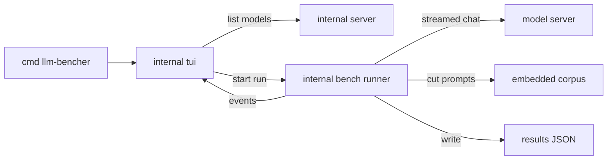

# Requirements

### Overview & Goals

Build a terminal benchmark tool for OpenAI-compatible local LLM servers, written in Go with Bubble Tea. It reproduces the prefill and greedy-decode benchmark from the kapitsa repo (`bench/harness/bench.py`) and nothing else from that repo: no inference engine logic, no tool calling, no agent replay, no sampled decode.

The model list comes live from `http://gaming:8080/v1/models`.

### Scope

**In Scope**
- A TUI model picker that lists every model id returned by `GET /v1/models`, with its `status` (loaded or unloaded).
- A run per selected model that measures:
  - Prefill TTFT and prefill tok/s on cold ~4K, ~16K, ~64K and ~128K token prompts. A size larger than the model's `context_length` is skipped with a reason.
  - Greedy decode tok/s over 512 generated tokens.
- A live run screen with phase progress, and a summary card at the end.
- Each run saved as a JSON file plus a summary shown in the TUI.

**Out of Scope**
- Sampled decode (T=0.6), cached-turn TTFT, tool calling, agent replay, memory footprint, and the kapitsa community submit flow.
- Engine management: starting, stopping, or loading models. The server is assumed to be running.
- Comparing runs across engines, and a history screen.

### User Stories

- As a user, I want to pick a model from the list the server reports, so I do not have to type model ids.
- As a user, I want prefill speed at 4K and 16K context, so I can judge long-prompt responsiveness.
- As a user, I want greedy decode tok/s, so I can compare generation speed under identical settings.
- As a user, I want each run saved as JSON, so results can be diffed and scripted later.

### Functional Requirements

- The picker fetches `GET {base}/models` where base defaults to `http://gaming:8080/v1` and is overridable by `--base-url`. Arrow keys or j/k move, Enter selects, Esc or q quits.
- If the list is empty or the request fails, the picker shows the error and offers retry or quit.
- A run performs, in order: warm-up, prefill 4K, prefill 16K, prefill 64K, prefill 128K (each skipped when target + 256 output tokens exceeds the model's `context_length`), greedy decode (median of 5 runs).
- Thinking is turned off for every request, so reasoning output does not count as answer tokens.
- A run is marked invalid when a check fails (see Technical Design, Validation). Invalid numbers stay in the output with a reason.
- The summary shows, per measurement, the median and min/max, and the path of the saved JSON file.
- Results are written to `results/<UTC timestamp>-<model slug>.json` by default, overridable with `--out`.

### Non-Functional Requirements

- Single static binary: the prompt corpus is embedded with `go:embed`, so no runtime data file is needed.
- Standard library for HTTP and JSON; Bubble Tea, Bubbles and Lip Gloss only for the UI.
- The corpus is Apache-2.0 excerpts of Hugging Face Transformers. Its notice and the license text are shipped in the repo.
- Cancelling with Ctrl+C during a run stops the in-flight request and exits cleanly without writing a partial result file.

# Technical Design

### Current Implementation

The `llm-bencher` repository is empty, so nothing exists to extend. The reference implementation is in `nace-ai/kapitsa`:

- `bench/harness/bench.py` is a stdlib-only Python harness. It measures against `/v1/chat/completions` in streaming mode. Relevant functions are `build_context`, `prefill_messages`, `decode_messages`, `sampling`, `body_of`, `t_prefill`, `t_decode`, `decode_rates`, and `check_sizes`.
- `bench/harness/corpus/bench_corpus.txt` is the frozen 650,000-character text corpus (sha256 `58a7756fd94fc48a7b7306d330b2c44663bdf22faa943f82430966c2878081b2`). `bench/harness/corpus/NOTICE.md` documents the source and Apache-2.0 license.
- `src/server/picker.cpp` is the terminal model picker reference: arrow keys, Enter to confirm, Esc to cancel.
- `src/server/bench_cmd.cpp` is the run screen reference: a spinner status line, phase lines with a check or warning mark per phase, and a summary card.

### Key Decisions

- **Language and TUI:** Go with Bubble Tea, Bubbles and Lip Gloss. Chosen by the user.
- **Runner and UI are separate packages.** `internal/bench` runs the measurements and emits progress events on a channel. `internal/tui` consumes them through Bubble Tea commands. The runner can be tested without a terminal.
- **Prompts come from an embedded corpus.** `internal/bench/corpus` embeds the corpus file, so every run gets byte-identical text. The sha256 is checked at startup.
- **A warm-up request runs before the timed prefill.** It is about 2,700 tokens taken from a corpus offset no timed prompt uses, as `bench.py` does with `WARM_TOKENS` and `WARM_OFFSET_CHARS`.
- **One model per run.** The picker chooses a single id; to benchmark another model, start a new run.
- **Request settings match `bench.py`:**
  - Thinking off via both `chat_template_kwargs.enable_thinking=false` and `reasoning_effort="none"`.
  - Greedy: `temperature=0`, `top_p=1`, `top_k=1`, `min_p=0`, `presence_penalty=0`, `frequency_penalty=0`, `repeat_penalty=1`.
  - Decode: `max_tokens=512`, stream on.
  - Prefill: `max_tokens=256`, so the answer ends naturally.
- **Metric definitions (as in `bench.py`):**
  - Prefill tok/s = `usage.prompt_tokens` / TTFT, where TTFT is the time from sending the request to the first content-bearing stream event.
  - Decode tok/s (greedy) = the middle window of the stream, dropping the first 16 and last 4 tokens, with the end-to-end `(tokens-1)/time` reported alongside.

### Proposed Changes

1. Initialise the Go module and CLI entry point. The entry point parses flags (`--base-url`, `--out`, `--model` to skip the picker) and starts the Bubble Tea program.
2. Model discovery reads `GET {base}/models` and returns `[]ModelInfo{ID, Status}`.
3. The corpus package embeds `bench_corpus.txt`, verifies its sha256, and cuts prompts by character count using `4.25` characters per token, as `build_context` does.
4. The streaming client sends `/chat/completions` with `stream: true` and `stream_options.include_usage: true`. It records TTFT, per-event timestamps, `finish_reason`, `usage`, and content.
5. Prefill runs the warm-up, then 4K and 16K. Each prompt carries a random nonce right after the system tag, so the prefix cache cannot be reused.
6. Decode runs 5 greedy requests on the decode prompt, each with a random run tag, and computes the median, min and max.
7. The runner emits `Event` values (phase started, progress, phase finished, run finished). The TUI maps them onto the run screen.
8. On completion, the runner writes the result JSON, and the summary screen shows the median values and the file path.

### Data Models / Contracts

```go
// internal/server
type ModelInfo struct {
    ID     string // "Devstral Small 2 24B"
    Status string // "loaded" | "unloaded"
}
func ListModels(ctx context.Context, base string) ([]ModelInfo, error)

// internal/bench
type Event struct {
    Kind  string // phase_start | progress | phase_end | done | error
    Phase string // warmup | prefill_4k | prefill_16k | decode_greedy
    Data  any
}
type Runner struct {
    Base, Model string
    Events      chan<- Event
}
func (r *Runner) Run(ctx context.Context) (*Result, error)

type Result struct {
    Schema     int
    Model      string
    StartedAt  time.Time
    Prefill    map[int]PrefillResult // 4000, 16000
    Decode     DecodeResult
    Corpus     string // sha256
}
type PrefillResult struct {
    Target, PromptTokens int
    TTFTSeconds, TPS     float64
    CachedTokens         int
    Invalid, Flags       []string
}
type DecodeResult struct {
    Runs                    []DecodeRun
    TPSMedian, TPSMin, TPSMax float64
    Invalid, Flags          []string
}
```

### File Structure

Added:
- `go.mod`
- `cmd/llm-bencher/main.go` (entry point, flags)
- `internal/server/models.go` (`ListModels`)
- `internal/bench/corpus/bench_corpus.txt` (copied from kapitsa, byte for byte)
- `internal/bench/corpus/NOTICE.md` (copied from kapitsa, attribution)
- `internal/bench/corpus.go` (go:embed, sha256 check, `BuildContext`)
- `internal/bench/prompts.go` (prefill and decode message builders, nonce)
- `internal/bench/stream.go` (SSE client, TTFT, usage capture)
- `internal/bench/prefill.go` (warm-up, 4K and 16K prefill)
- `internal/bench/decode.go` (greedy decode, middle-window rate)
- `internal/bench/runner.go` (orchestration, `Event` channel)
- `internal/bench/result.go` (`Result` types, median and min/max, JSON write)
- `internal/tui/app.go` (root model and screen state)
- `internal/tui/picker.go` (model picker screen)
- `internal/tui/run.go` (run progress screen)
- `internal/tui/summary.go` (summary card screen)
- `LICENSE` (Apache-2.0 text, copied from kapitsa)

### Components

- **Picker:** a list of `ModelInfo`, with the status shown in a column; loads on init and handles an error state.
- **Run screen:** a Bubbles spinner plus one line per phase (warm-up, prefill 4K, prefill 16K, decode greedy), with a check or warning mark and the measured value.
- **Summary:** a bordered card with the medians and the result file path.

### Architecture Diagram



### Risks

- **Tokenizer-dependent prompt length:** the reference prompt-token counts (4133 and 16286) were measured with Qwen tokenizers, so other models will differ. Mitigation: check `prompt_tokens` within ±1% only when the model is a Qwen family id, and otherwise record it as unchecked.
- **Model loading:** the server (llama-swap) loads unloaded models on the first request. Mitigation: the warm-up absorbs the load, and the status shown in the picker says whether it is loaded.
- **Long requests:** a 16K prefill on a slow machine can take minutes. Mitigation: use a request timeout of at least 30 minutes, as `bench.py` does, and keep the Ctrl+C cancellation path.
- **Server unreachable at run time:** the run fails in its first phase. Mitigation: the phase shows the error, no partial JSON is written, and the summary returns to the picker.
- **Corpus licence:** Apache-2.0 requires the notice and license text to ship with the embedded file. Mitigation: `NOTICE.md` and `LICENSE` are copied into the repo.

# Testing

### Validation Approach

All checks are automated and runnable by the agent without a GPU server: `go test ./...`, `go vet ./...`, and `go build ./cmd/llm-bencher`. Behaviour against an OpenAI-compatible server is tested with `httptest` fake servers that return canned SSE streams and `/v1/models` JSON. A real run against `http://gaming:8080/v1` is an optional manual check, because it needs the GPU.

### Key Scenarios

- `ListModels` parses a fixture `/v1/models` response and returns each `id` with its `status.value`.
- The picker, given a list of three models, moves selection with j/k and returns the chosen id on Enter.
- `BuildContext(4000)` returns about 17,000 characters, and `BuildContext(16000)` returns about 68,000 characters, both from the embedded corpus.
- The embedded corpus sha256 equals `58a7756fd94fc48a7b7306d330b2c44663bdf22faa943f82430966c2878081b2`.
- The prefill message nonce differs between two calls, so cache-busting is covered.
- The stream parser computes TTFT and `prompt_tokens` from a fixture SSE stream that includes a usage chunk.
- The decode middle-window rate drops the first 16 and last 4 tokens for a 512-token fixture.
- `Median`, `Min` and `Max` return the expected values for a 5-run fixture.
- A full `Runner.Run` against a fake server emits phase events in the order warm-up, prefill 4K, prefill 16K, decode greedy, and writes a JSON file matching the `Result` schema.

### Edge Cases

- `/v1/models` unreachable, returns HTTP 500, or returns an empty `data` array: the picker shows the error and offers retry.
- A stream that ends without `usage`: the run is marked invalid with the reason `usage.prompt_tokens missing`.
- A decode run whose `finish_reason` is not `length`, or whose `completion_tokens` differs from 512: flagged, but the number is kept.
- A response that includes reasoning content or `<think>` tags: the run is marked invalid.
- A prompt-token count outside ±1% of the reference for a Qwen model: marked invalid. For non-Qwen models the same check is recorded as unchecked.
- Ctrl+C during a run: the in-flight request is cancelled through the context, and no result file is written.
- The corpus file is modified: the startup sha256 check fails with a clear error.

### Test Changes

- New tests live next to each package (`*_test.go`). Fixtures are stored under `internal/**/testdata/`.
- No existing tests to update, since the repo is empty.
- Intentionally skipped: a live GPU benchmark in CI, and snapshot tests of the rendered TUI string.

# Delivery Steps

### ✓ Step 1: Scaffold module, CLI entry, and model picker
The binary starts and shows the list of models reported by the server, with status, and lets the user select one.

- Create `go.mod` and `cmd/llm-bencher/main.go` with `--base-url` (default `http://gaming:8080/v1`), `--out`, and `--model` flags.
- Implement `internal/server/models.go` with `ListModels(ctx, base)` that parses `data[].id` and `data[].status.value`.
- Implement `internal/tui/app.go` and `internal/tui/picker.go` as a Bubble Tea model with j/k and arrow navigation, Enter to select, and Esc or q to quit. Show an error state with retry on failure.
- Add `httptest` tests for `ListModels` and for the picker's Update transitions.

### ✓ Step 2: Embed prompt corpus and build cut prompts
Prompts of 4K and 16K tokens are produced from the embedded corpus, and the corpus integrity is verified at startup.

- Copy `bench_corpus.txt`, `NOTICE.md` and `LICENSE` from kapitsa into `internal/bench/corpus/` and the repo root, byte for byte.
- Implement `internal/bench/corpus.go` with `go:embed`, a sha256 check, and `BuildContext(tokens)` using 4.25 characters per token.
- Implement `internal/bench/prompts.go` with `prefillMessages(ctx, nonce, question)` that puts a random nonce right after the system tag, and `decodeMessages()` with a random run tag.
- Add unit tests for the sizes, the checksum, and the nonce uniqueness.

### ✓ Step 3: Implement streaming client and prefill measurement
Cold prefill TTFT and prompt tokens are measured for 4K and 16K prompts after a warm-up request.

- Implement `internal/bench/stream.go`, an SSE client for `/chat/completions` with `stream: true`, `stream_options.include_usage: true`, and thinking disabled. It records TTFT, per-event timestamps, `finish_reason`, `usage`, and content.
- Implement `internal/bench/prefill.go` with a warm-up of about 2,700 tokens from a corpus offset no timed prompt uses, then prefill at 4K and 16K. Compute prefill tok/s as prompt tokens divided by TTFT.
- Apply the validity rules: missing usage is invalid, a cold cached-token count above 16 is invalid, and the ±1% prompt-token check applies only to Qwen ids.
- Add `httptest` tests with fixture SSE streams for TTFT, usage parsing, and each validity rule.

### ✓ Step 4: Implement greedy decode measurement
Greedy decode tok/s is measured over five 512-token runs with the middle-window rate.

- Implement `internal/bench/decode.go` with greedy sampling (`temperature` 0, `top_p` 1, `top_k` 1, penalties 0) and `max_tokens` 512.
- Compute the middle-window rate by dropping the first 16 and last 4 tokens, and the end-to-end rate alongside.
- Flag `finish_reason` other than `length` and `completion_tokens` other than 512, and mark reasoning output invalid.
- Implement median, min, and max in `internal/bench/result.go`.
- Add tests for the window math, the statistics, and the flags, using fixture streams.

### ✓ Step 5: Wire the runner, run screen, summary, and JSON output
A user can select a model, watch the four phases run, see the summary card, and find the saved JSON file.

- Implement `internal/bench/runner.go` with `Runner.Run(ctx)` that executes warm-up, prefill 4K, prefill 16K, then decode greedy, emitting `Event` values on a channel.
- Implement `internal/tui/run.go` with a Bubbles spinner and one line per phase showing a check or warning mark and the measured value.
- Implement `internal/tui/summary.go` with a bordered card showing the medians, min/max, and invalid or flagged reasons, plus the saved path.
- Write `results/<UTC timestamp>-<model slug>.json` from `result.go`, and skip writing on cancellation.
- Add an end-to-end test against an `httptest` fake server that checks event order and the JSON schema.

### ✓ Step 6: Add prefill at 64K and 128K
Cold prefill is also measured at 64K and 128K tokens. A size that does not fit the model's `context_length` is skipped with a reason, so the run still completes and saves its JSON.

- Read `context_length` from `GET /v1/models` into `ModelInfo`, and pass it to the runner.
- Extend the prefill sizes to 4000, 16000, 64000 and 128000 in `internal/bench/runner.go`, and add the two phases to `internal/tui/run.go`.
- Skip a prefill size when its target plus the 256 output tokens exceeds `context_length`. Record it in the result with a reason, and show it as skipped on the run screen.
- Move the warm-up offset so it does not overlap the 64K and 128K prompts. The corpus is 650,000 characters, and 128K needs 544,000.
- There are no reference prompt-token counts for 64K and 128K, so the ±1% check is recorded as unchecked for those sizes.
- Update the summary card, the result JSON, and tests for the skip rule, the warm-up offset, and the event order.

### ✓ Step 7: Add greedy decode at 4K, 16K and 64K context
Greedy decode is also measured after a prompt of each context size, so generation speed at long context is visible. A size whose target plus 512 output tokens exceeds `context_length` is skipped with a reason. The base decode on the short fixed prompt is kept.

- Add `DecodeContextSizes` 4000, 16000 and 64000 to `internal/bench/runner.go`. Each size gets five greedy 512-token runs, the same method as the base decode, with the median, min and max.
- Build the decode prompt from the corpus with `BuildContext` in `internal/bench/decode.go`, with the system and user messages from `internal/bench/prompts.go`. Use a random nonce per run so the prefix cache cannot be reused.
- Apply the skip rule with 512 output tokens for decode, not 256. Record skipped sizes in the result under a decode-by-context key, and show them as skipped on the run screen.
- Add `internal/tui/run.go` phase lines for decode at 4K, 16K and 64K, and show them in `internal/tui/summary.go`.
- Update the result JSON schema and tests for the skip rule, the window math on a context-sized decode, and the event order.

### ✓ Step 8: Add 32K and 96K sizes, and 2-run decode at 96K and 128K
Prefill and context decode also run at 32K and 96K, and context decode also runs at 128K. Context decode at 96K and 128K uses 2 runs instead of 5. The skip rule and the 5% prompt overshoot margin still apply.

- Add 32000 and 96000 to `prefillSizes` in `internal/bench/runner.go`, with phases `prefill_32k` and `prefill_96k`.
- Add `decode_32k`, `decode_96k` and `decode_128k` to `decodeSizes`, each with its run count: 5 for 4K, 16K, 32K and 64K, and 2 for 96K and 128K. Pass the run count through `MeasureDecodeAt` in `internal/bench/decode.go`.
- Keep the warm-up at 600,000 characters, which does not overlap the largest prompt (128K needs 544,000 characters).
- Add the new phase lines to `internal/tui/run.go` and the new rows to `internal/tui/summary.go`.
- Update the phase-order and skip-rule tests in `internal/bench/runner_test.go`, and add a test for the run counts.

### ✓ Step 9: Take prefill values from the context decode runs
Prefill TTFT and prefill tok/s at 4K to 128K come from the decode-at-context requests, so no separate prefill requests are sent. The warm-up and the short-prompt decode stay as they are.

- In `internal/bench/decode.go`, extend `DecodeRun` with `TTFTSeconds` and `PromptTokens`, filled from each `StreamResult` in `decodeRun`, so each context decode run keeps the cold-prefill numbers it already measures.
- In `internal/bench/prefill.go`, reuse `validatePrefill` for each context decode run, so the usage, cached-token and reference checks apply to those runs too.
- In `internal/bench/runner.go`, remove `prefillSizes` and the `PhasePrefill*` constants. Run warm-up, then decode greedy, then the decode-at-context sizes. For each size that runs, build `Result.Prefill[size]` from its runs.
- Skip a size when `fitsContext` with 512 output tokens fails, in both the prefill and the decode result. This replaces the 256-token prefill check from Step 6 and Step 8. The 5% overshoot margin stays.
- In `internal/bench/result.go`, `PrefillResult` gains `TTFTSamples []float64` with one value per run. `TTFTSeconds` is the median, and `TPS` is prompt tokens divided by the median TTFT. The `prefill` key and its other fields stay the same, and `resultSchema` moves from 1 to 2.
- In `internal/tui/run.go`, remove the prefill phase lines. Each decode-at-context line shows the median TTFT and prefill tok/s next to its decode rate.
- In `internal/tui/summary.go`, the prefill rows keep reading `Result.Prefill` by size, so no key changes are needed there.
- Update `internal/bench/runner_test.go`: the phase order becomes warm-up, decode greedy, then decode 4K to 128K. Add a check that each size's `TTFTSamples` has one entry per run, and that prefill keys come from the decode runs.
- Confirm the decode prompt's `prompt_tokens` at 4K and 16K still falls within ±1% of `referencePromptTokens`, because the decode prompt differs from the old prefill prompt. If it does not, re-measure the references before keeping the check.

### ✓ Step 10: Sidecar config for API URL and runs per context size
The API base URL and the run count per size are read from a JSON sidecar file, so they no longer live in code. Only OpenAI-compatible APIs are supported.

- Add a sidecar file `llm-bencher.json` in the working directory with `base_url` and a `runs` map. Keys are `greedy`, `4k`, `16k`, `32k`, `64k`, `96k` and `128k`. Defaults match the current values: 5 runs for every size except 96k and 128k, which use 2.
- Load the sidecar at start. A missing key falls back to its default. The default base URL is removed from code.
- If no base URL is saved and `--base-url` is not given, the TUI shows a text prompt for the API base URL before the picker, then saves it to the sidecar.
- Keep `--base-url` as a per-session override that is not written to the sidecar.
- Use the sidecar run counts in the runner for the base decode and for each context decode size, and show the counts on the run screen labels.
- Add tests for the sidecar load, defaults, save, and the URL prompt transitions.